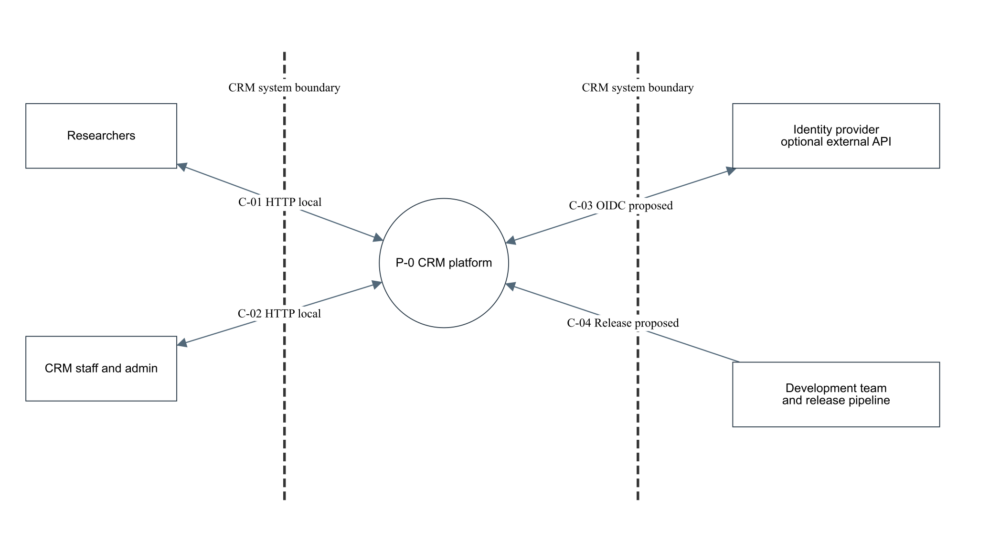
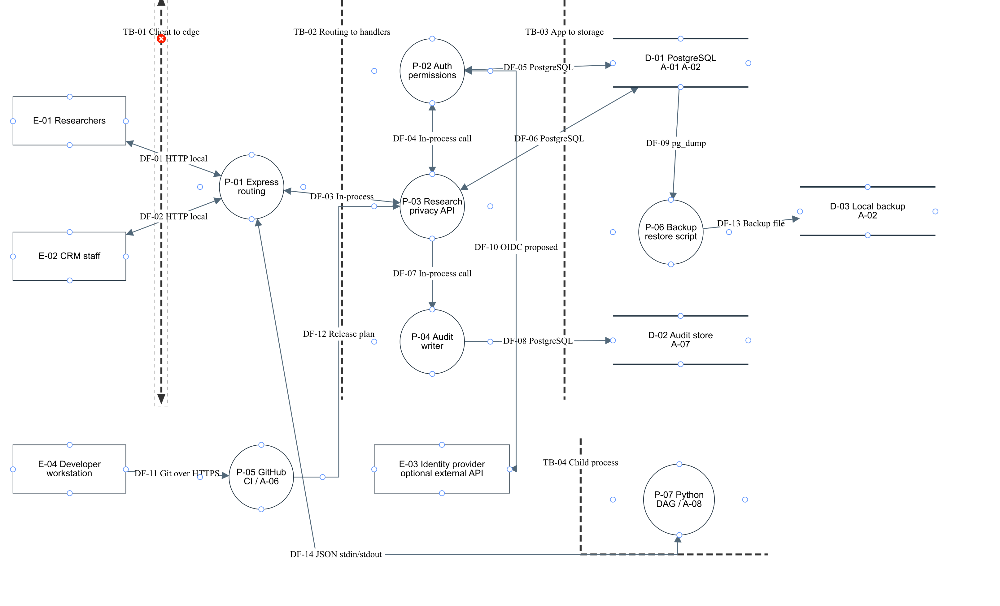
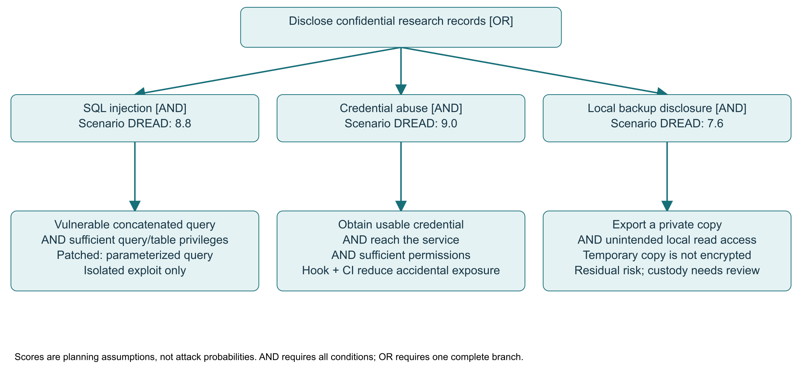

# CRM Application Security Architecture
## PBL Milestone: Application Security Architecture and Software Engineering Integration

III-BCSAD • bolanatics • 4 October 2026

Center for Research Management (CRM) Research Services and Information Management Platform

Repository: https://github.com/a-a123456789/umak-research-management

| Member / student ID | Classroom C-suite / engineering role | Section owner |
|---|---|---|
| Arnaez, Anjelo Benedict / K12254175 | CEO / executive sponsor | IV and final compilation |
| Ducay, Justin Andrew / A12448793 | CIO / infrastructure lead | II; diagram and recovery support |
| Balocating, Aaliyah Marie / A12448769 | CISO / risk lead | V–VI; framework alignment |
| Maligaya, Gian Brent / A12448912 | Lead software engineer / DevSecOps | I; code, Git and demonstration |
| Bomediano, John David / A12448927 | DPO / compliance specialist | III; privacy/legal review |

Writing assignments do not alter defense responsibilities. These roles describe the five-student project team; they are not appointments to university offices. No signature, official notification or human review is asserted. One designated member submits the portfolio and repository URL through TBL Hub. Confirm the official deadline separately.

## Executive scope and evidence status

This report consolidates the six laboratory topics around the implemented synthetic CRM backend. It preserves the completed team sections as source material while correcting mismatched project names, stack claims, legal statements, risk assumptions and evidence. CRM means Center for Research Management. “Online Repository Management System” and “UMak-RMLIS” are earlier labels for this course project, not evidence of additional deployed systems [1].

The implementation uses Express/Node 24, PostgreSQL 18, local bearer sessions, Python DAG computation and GitHub Actions. No complete frontend, cloud deployment, Google SSO, Redis, uploads or Turnitin integration is claimed. Production-grade architecture is the design target; the submitted system is a bounded teaching prototype. Production approval depends on institutional policy, HTTPS, operational isolation, retention and human review.

Local checks and integration GitHub CI have executed. Commands, outputs and commit IDs are retained under `evidence/integration/`; exact final merge and protection status belongs to the completion ledger. Financial inputs remain scenario estimates, incident response is an academic simulation, and automated checks are distinct from peer review.

## I. Enterprise governance and asset inventory

### System profile and reporting lines

The system supports approved research discovery, authenticated record creation/read access, optional privacy preferences, reviewed synthetic deletion, and staff-only workflow estimation. Researchers and CRM staff are distinct application roles. Git contributors and database administrators are separate operational identities; being a student CEO does not automatically grant a staff API account or production database access.

Classroom reporting: Lead Engineer and CIO report implementation/recovery evidence to CEO; CISO reports threat priorities and residual risks directly to CEO; DPO independently raises privacy concerns to CEO and the actual institutional authority when appropriate. The CISO can request a release hold for an unresolved severe flaw, while CEO records the project decision. Actual university officers retain institutional authority. This separates budget/scope decisions, technical execution and risk review [2], [3].

CEO owns priorities and risk acceptance; CIO owns environment, backups and architecture accuracy; CISO owns STRIDE, DREAD, register and NIST/ISO alignment; Lead Engineer owns patches, tests and Git configuration; DPO owns legal mapping, data minimization and simulation labeling. A release exception requires a reason, exact affected rule, passing evidence and restoration record. This integration's owner-authorized approval exception is not peer review.

### Asset inventory and classification

The following are stable project IDs, not an inventory of real university data. Confidentiality classes apply to intended data; current records are synthetic.

| ID / asset | Custodian / location | Classification | Security priorities |
|---|---|---|---|
| A-01 identities, sessions, consent | Gian / PostgreSQL | Restricted | Confidentiality, authenticity, privacy; prevent impersonation |
| A-02 research records and backups | Justin / operational DB and temporary dump | Confidential; approved metadata public | Confidentiality, integrity, availability, possession/control |
| A-03 service-workflow records | John David / proposed persistence adapter | Confidential, proposed | Integrity, privacy, authentic evidence gates |
| A-04 public research information | Justin / approved search response | Public | Integrity and availability; public does not mean writable |
| A-05 credentials | Gian / ignored local environment, ephemeral CI | Restricted | Confidentiality and possession/control |
| A-06 source, CI and models | Gian / private Git repository | Internal | Integrity, authenticity and availability |
| A-07 audit events | Aaliyah / logical audit store in PostgreSQL | Confidential | Integrity, accountability and controlled retention |
| A-08 workflow scenarios/results | Gian / bounded worker memory and response | Internal synthetic; future confidential | Integrity, availability and honest estimate interpretation |

CIANA-PS interpretation: confidentiality restricts private records; integrity preserves states and gates; availability enables service; nonrepudiation is supported only partly by attributable logs, not proven by them; authenticity binds the session; privacy minimizes personal fields; possession/control restricts copies and credentials. Audit administrators can still change logs. These objectives must be balanced: deletion and accountability require defined retention, while availability limits must not imply unrestricted data access [2], [4].

## II. Attack surface, Kill Chain and code remediation

### Actual stack and attack surface

| Entry/component | Asset / failure mode | Implemented control | Evidence / remaining limit |
|---|---|---|---|
| Express public search | A-02/A-04 SQL injection, broad result sets | Parameterized query, Approved filter, 100-row cap, 200-character keyword | SQLi demo and regression test; no full penetration test |
| Login/session routes | A-01 brute force, token theft | Salted scrypt, random hashed one-hour bearer token; login/general throttling; revocation | Auth tests; local HTTP requires production HTTPS |
| Record read/create | A-02 object access or forged ownership | Owner-or-staff predicate; server author ID; Draft-only creation | Cross-user denial and staff success tests |
| Consent/deletion | A-01/A-02 forged choices or erasure | Strict fields, server identity/time, staff-reviewed transaction | Privacy tests; backup erasure is proposed |
| Algorithm solve/worker | A-08 DoS, forged evidence scenario | Staff-only, graph limits, two workers, timeout, output cap, fixed script/no shell | Worker/API tests; scenario not institutional verification |
| PostgreSQL | A-01/A-02/A-07 excessive privilege | Separate non-owner runtime; PUBLIC grants revoked; audit INSERT/SELECT only | Permission tests; no RLS or immutable audit system |
| Git and CI | A-05/A-06 committed secrets/supply chain | Local hook, Gitleaks, Semgrep, dependency audit, required checks | Actual hook rejection and CI; native private-repo push protection unavailable |
| Optional external services | Proposed identity/storage/upload features | No active integration or route | Review before enabling; do not claim current attack evidence |

Vulnerability classifications: SQL injection is CWE-89; missing authorization is CWE-862; uncontrolled resource consumption is CWE-400. Parameterization and explicit authorization align with OWASP verification guidance [5], [6]. The isolated vulnerable app is never imported by normal startup.

### Seven-phase Kill Chain with ATT&CK mapping

This is a conditional, proposed upload-parser intrusion scenario, retained to correct the team's original chain. It is not the demonstrated SQLi result. Uploads are not implemented; a malicious file alone does not execute JavaScript or establish a foothold. Kill Chain stages and ATT&CK techniques are complementary models rather than one-to-one taxonomies [7], [8].

| Phase | Conditional action / ATT&CK ID | Defense and present status |
|---|---|---|
| Reconnaissance | Scan for exposed routes / T1595.002 Vulnerability Scanning | Minimal routes and throttling; external attack simulation not run |
| Weaponization | Develop an exploit for an actual parser flaw / T1587.004 Exploits | Defer parser; dependency checks on implemented stack |
| Delivery | Send exploit to a future public upload service / T1190 Exploit Public-Facing Application | No upload endpoint exposed |
| Exploitation | Trigger the vulnerable server parser / T1190 | Requires a specific exploitable flaw, not merely accepting a PDF |
| Installation | Install a web shell after sufficient execution/write access / T1505.003 Web Shell | No runtime upload execution path; future isolation review |
| Command and control | Use web protocols from compromised host / T1071.001 Web Protocols | Production egress policy proposed, not tested |
| Actions on objectives | Encrypt accessible data for impact / T1486 Data Encrypted for Impact | Least privilege and synthetic restore verified; immutable recovery proposed |

### Actual vulnerable and patched proof

The demonstration creates temporary synthetic tables and runs the same UNION payload against the isolated concatenating example and the normal parameterized search. It then removes its temporary schema. The vulnerable result contains a fake credential sentinel; the patched result is HTTP 200 with an empty array. Successful prevention need not return 401 because search itself is public.

```
Vulnerable principle: SQL text embeds the supplied keyword directly.
Patched query:
SELECT id,title,abstract,status FROM research_records
WHERE status='Approved' AND title ILIKE $1 ORDER BY id LIMIT 100
Bound value: '%' + keyword + '%'
Payload: ' UNION SELECT id, email, password_hash, role FROM users--
```

Actual command: `npm run demo:sqli`. The before/after JSON and PASS assertion are recorded in `evidence/integration/local-checks.txt`. Tests separately check approved-only normal results, cross-user denial, valid staff access and malformed input. The demo proves a specific query control on synthetic data; it does not prove every route or database grant is secure.

## III. Legal compliance, privacy by design and incident response

The following are engineering mappings for academic analysis, not legal certification. The actual institutional DPO must confirm processing purposes, lawful basis, retention and notification decisions. Older statutes and the 2016 NPC circular are deliberately cited using their actual dates [9]–[11].

### Five provisions from each law

| Law / provision | CRM design implication | Control and verification boundary |
|---|---|---|
| RA 10173 §11 | Transparency, legitimate purpose, proportionality | Collect minimal consent fields; privacy notice and retention schedule need institutional confirmation |
| RA 10173 §12 | Establish lawful processing criteria | Optional choices recorded separately; no claim that a checkbox legalizes core processing |
| RA 10173 §13 | Special conditions for sensitive/privileged data | Synthetic data only; real educational/research data classification and authority review required |
| RA 10173 §16 | Data-subject rights including applicable blocking/removal | Reviewed deletion request; real rights workflow/retention exceptions need confirmation |
| RA 10173 §20 | Appropriate organizational, physical and technical safeguards | Tested authorization, session handling and backup recovery; production safeguards remain partly proposed |
| RA 10175 §4(a)(1) | Illegal access risk | Authentication, staff/owner checks, database privilege separation |
| RA 10175 §4(a)(2) | Illegal interception risk | Production TLS required; local HTTP is not protected transport evidence |
| RA 10175 §4(a)(3) | Data interference risk | Parameterized SQL and constrained record writes; audit attribution |
| RA 10175 §4(a)(4) | System interference risk | Body/graph/concurrency/time limits and restoration exercises |
| RA 10175 §4(a)(5) | Misuse of devices risk | Restrict credential/tool access; keep vulnerable demonstration isolated and authorized |

### Consent JSON and API

Authenticated `POST /api/v1/users/consent` accepts exactly `policy_version` and `choices`. The supported version is `2026-10-v1`. Choices are two required booleans; both may be false. Client-supplied user ID or timestamp is rejected. The server records identity from the session and time from PostgreSQL; repeated requests append preference history, with the latest record representing current optional choices.

```
{"policy_version":"2026-10-v1",
 "choices":{"institutional_analytics":false,"email_notifications":false}}
```

HTTP 201 returns `id,user_id,policy_version,choices,recorded_at`; invalid fields/version return 400; missing or invalid session returns 401. No IP address, user agent, real name, email-delivery integration or analytics processing is added by this route. Production must explain purpose, withdrawal, retention and the distinct lawful basis for necessary service processing [9].

### Deletion and backup handling

A student sends `{}` to `POST /api/v1/users/deletion-requests`; HTTP 202 returns request ID, status and server request time. Repeating a pending request reuses it. Only staff can complete `/api/v1/admin/deletion-requests/:id/complete` with `{"confirm_review":true}`. The transaction deletes the synthetic user and cascades research records, sessions and consents; the request loses its personal user link and a minimal staff-attributed audit event remains. Completion returns a warning that backup erasure is not implemented.

Soft deletion only hides records. Hard deletion removes operational rows but does not erase historical backups. Proposed production procedure: confirm authority/holds; erase eligible data; maintain a restricted deletion ledger outside backups; expire recovery copies on an approved retention schedule; replay deletion events after restoration before opening traffic; review audit retention and minimize retained identifiers. Cryptographic shredding requires per-subject encryption keys and verified destruction of all recoverable copies; no KMS or shredding implementation is claimed.

### Six-stage incident response — academic simulation

Scenario: a synthetic alert suggests unauthorized research disclosure. No actual university incident, affected-person count, containment action or notification is asserted. The six stages below are a rehearsal playbook; production timing and responsibility must be adopted by the real institution [11], [12].

| Stage | Owner and action | Evidence to produce in a real incident |
|---|---|---|
| Identify | CISO triages alert; DPO assesses personal-data exposure | Record discovery time, source, confidence and known unknowns |
| Contain | CIO/Engineer restrict affected route and revoke compromised sessions/credentials | Preserve logs before destructive changes; record scope and containment time |
| Analyze | CISO/Engineer correlate authorized logs and changes | Identify affected data, access path and uncertainty; preserve chain of custody |
| Eradicate | Engineer patches root cause and rotates affected credentials | Reviewed fix, dependency review and repeated exploit test |
| Recover | CIO restores verified copies and checks integrity | Replay approved deletions before traffic; compare records and monitor recurrence |
| Lessons learned | CEO convenes CISO/DPO/team | Update policies, threat model, backlog and training; document accountable follow-up |

NPC notification is not triggered by every security event. Assess the legally specified breach conditions and, when notification is required, the 72-hour requirement runs from knowledge or reasonable belief as specified in the applicable rules. Uncertainty must be communicated and updated, not replaced with invented facts [11].

### Draft NPC notice — ACADEMIC INCIDENT SIMULATION, NOT SUBMITTED

To: National Privacy Commission (submission channel to be verified by actual institutional DPO). Reporting controller: [actual institution and authorized contact to be confirmed]. Discovery time: [unknown; enter verified time]. Nature: suspected unauthorized disclosure of research-related personal data. Data and individuals affected: [categories/count unknown pending investigation]. Likely consequences: [assessed risks, not assumed actual harm]. Containment and recovery: [verified actions/times only]. Measures for affected people: [reviewed guidance]. Notification basis and timing: [DPO assessment and evidence]. Next update: [authorized schedule]. No signatory or official appointment is fabricated. This template must not be sent as an actual incident report.

## IV. EISP, system policy and Git guardrails

### Five-part Enterprise Information Security Policy charter

1. Purpose and authority: protect CRM research, identities and service availability; this is a proposed classroom charter under CEO coordination, subject to university authority before real adoption.
2. Scope and objectives: cover team devices, source repository, synthetic API, database, worker, backups and documentation; preserve confidentiality, integrity, availability, authenticity, privacy and accountability.
3. Responsibilities: apply the governance roles in Section I; separate runtime/database administration, implementation/risk acceptance, and privacy/legal review. Student titles do not confer institutional power.
4. Mandatory practices: default deny, least privilege, parameterized access, secret exclusion, bounded inputs/workers, approved changes, protected audit access, tested recovery and prompt incident escalation. Use synthetic data in demonstrations.
5. Compliance and review: record exceptions with owner, reason, expiration and compensating checks; review per milestone and after incidents or architecture changes. Violations are handled through course/university procedures, never invented penalties or unilateral access to real records.

### Managerial policy

Changes require an identifiable author, linked risk/ticket, passing checks and normal peer review. The project owner may authorize a documented one-time review exception with restoration; passing CI is not peer approval. Production processing, hosting and retention changes require the actual institutional authority. Monthly classroom access reviews and per-release recovery rehearsal are proposed operating routines, not claims of completed meetings.

### Five-column default-deny ACL

| Subject | Resource / action | Decision | Condition | Enforcement / evidence |
|---|---|---|---|---|
| Anonymous | Health; approved research search | Allow read | Valid bounded keyword; Approved only; max 100 rows | Express public routes and search tests |
| Anonymous | Private records, consent, solver, audit | Deny | No valid session | 401 assertions |
| Student | Own record read / own Draft creation | Allow | Authenticated identity; server ownership | SQL owner predicate and creation tests |
| Student | Another owner's private record / staff route | Deny | No ownership/staff grant | 404 object hiding / 403 staff denial |
| Student | Own consent / deletion request | Allow | Valid body, policy and session | Privacy tests and server identity |
| Staff | Record reads, audit reads, reviewed deletion | Allow | Staff role; explicit deletion confirmation | Staff middleware and transaction tests |
| Staff | Algorithm scenario solve | Allow | Strict graph/body bounds; worker admission | Algorithm API and failure tests |
| Runtime DB role | Operational queries; audit INSERT/SELECT | Allow scoped grants | Non-owner authenticated DB connection | Schema grants and DB permission tests |
| Runtime DB role | Audit UPDATE/DELETE; schema DROP | Deny | Never granted | SQLSTATE 42501 assertions |
| Any unlisted subject/action | Any resource | Deny | No explicit rule | Route 404, middleware and revoked PUBLIC privileges |

Working configuration lives in `src/app.js`, `src/algorithm.js`, `db/schema.sql`, `compose.yaml`, `.githooks/pre-commit`, `.gitleaks.toml`, `.semgrep.yml` and GitHub workflows. The local HTTP binding is loopback; deployment TLS and network controls are not inferred from a diagram [13].

### Comparative framework roadmap

| Phase / owner | NIST CSF 2.0 alignment | ISO/IEC 27001:2022 alignment | Concrete deliverable |
|---|---|---|---|
| Define / CEO+CISO | Govern, Identify | Clauses 4–6 context, leadership, planning | Scope, asset owners, risk register and acceptance criteria |
| Implement / CIO+Engineer | Protect, Detect | Clause 8 operation; selected Annex A controls | Access/configuration rules, secure development checks, attributable logs |
| Rehearse / CIO+DPO | Respond, Recover | Operational response and continuity controls | Synthetic playbook, restore evidence, breach assessment template |
| Evaluate / CISO+CEO | Govern and improvement across functions | Clauses 9–10 evaluation and improvement | Review metrics, residual-risk decisions and corrective backlog |

NIST supplies a flexible outcomes vocabulary; ISO 27001 specifies an auditable management-system requirement set. This mapping is a project roadmap, not ISO certification or a completed NIST assessment [2], [3].

### Three-tier SETA plan

Awareness, all users: brief secret/privacy and receipt-versus-verification reminders at onboarding and monthly; measure completion and a short quiz. Training, developers/staff: per-release practice of access-control tests, incident triage and restore rehearsal; require execution evidence. Education, project leaders: each milestone discuss risk math, legal duties and framework tradeoffs; use oral scenario defense. These are scheduled proposals; do not invent attendance records.

### Git rulebook and exception

Use feature branches and pull requests. Keep `.env`, dumps, raw credentials and production personal data out of Git. Install the hook with `npm run hooks:install`; local hooks can be bypassed, so Gitleaks CI provides a second check. Required CI includes dependency audit, static analysis, security tests, model/risk consistency and ALGOCOM correctness/performance. Normal main policy requires two approvals, stale-review dismissal, a reviewer other than the last pusher, passing `security` and `algocom` checks, linear history and resolved conversations. No force pushes or deletion.

Integration uses the owner's explicitly authorized approval exception: only review requirements are temporarily relaxed after passing checks; restoration is attempted in a finally path and verified. The exact applied state is recorded in the merge ledger. Native GitHub secret scanning/push protection returned unavailable for this private account/repository; do not claim those features were enabled. Privacy remains private unless separately authorized.

## V. Asset valuation, TVA and quantitative risk

### Four-attribute profile and valuation basis

A-02 is the research-record collection. Business owner: project CEO representing the proposed CRM service; technical custodian: CIO; location: PostgreSQL and temporary recovery copies; classification/criticality: confidential unpublished records with high integrity and availability needs. Existing approved metadata is public. No real university record inventory or incident-loss dataset was supplied.

Retained Lab 5 scenario AV=PHP 3,600,000: engineering/reconstruction 920,000; operational interruption 800,000; response/legal/penalty contingency 1,880,000. These are planning estimates, not invoices, fines, statutory penalty calculations, observed university losses or empirical valuation evidence. The contingency is particularly uncertain. Obtain institutional estimates or documented quotations before budget approval [1], [4].

### Five categories and eleven TVA triples

Each row is an explicit threat-agent / vulnerability / asset combination. Five categories have at least two triples; the eleventh adds audit repudiation. Controls are updated to the actual prototype or clearly proposed scope.

| TVA / category | Agent | Vulnerability | Asset |
|---|---|---|---|
| TVA-01 / Software attacks | External web attacker | Concatenated user input in research search SQL. | A-02 |
| TVA-02 / Software attacks | Authenticated peer | Record retrieval checks login but not permission on the requested record. | A-02; A-03 |
| TVA-03 / Human error or failure | Deployment administrator | Private exports or backup objects inherit public-read storage permissions. | A-02 |
| TVA-04 / Human error or failure | Developer mistake then external attacker | Live service credentials or signing secrets are committed to version control. | A-05; A-02 |
| TVA-05 / Espionage or trespass | Authenticated peer exploiting another query flaw | Broad service role has no row policy or equivalent verified isolation. | A-02 |
| TVA-06 / Espionage or trespass | Network observer or session thief | An HTTP/session path exposes credentials or cookies. | A-01; A-02 |
| TVA-07 / Information extortion | Ransomware operator | Optional attachment parser is vulnerable or execution is permitted in upload storage. | A-02 |
| TVA-08 / Information extortion | Ransomware operator with credentials or DB exploit | Public DB route plus exploitable authentication or overprivileged credentials. | A-02 |
| TVA-09 / Sabotage or vandalism | Abusive client | Search cost, request rate or body size is unbounded. | A-02; A-04; A-08 |
| TVA-10 / Sabotage or vandalism | Malicious record contributor | Untrusted research text reaches an unsafe HTML rendering sink. | A-02; A-01 |
| TVA-11 / Sabotage or vandalism | Malicious authorized editor | Research updates lack an attributable append-only audit record. | A-07; A-02 |

### SLE, ALE, safeguard cost and CBA

The scenario follows the course risk arithmetic [4]: SLE=AV×EF; ALE=SLE×ARO; CBA=ALE_before−ALE_after−ACS. Use EF=0.40, prior ARO=2/year, target ARO=0.05/year, annual safeguard cost ACS=PHP 240,000. Thus SLE=1,440,000; prior ALE=2,880,000; target ALE=72,000; CBA=2,568,000; illustrative return on security investment=(2,808,000−240,000)/240,000=1,070%.

This positive result is conditional on the unverified frequency and effectiveness estimates. It is not measured savings or proof that safeguards reduce real incidents to 0.05/year. Do not sum the eleven risk rows' costs again: their allocations partition the same PHP 240,000 bundle. Avoid adding correlated breach losses as if independent.

| Sensitivity scenario | AV / EF / ARO before→after | ACS (PHP) | CBA (PHP/year) |
|---|---|---|---|
| Retained planning case | 3.6m / .40 / 2→.05 | 240,000 | 2,568,000 |
| Lower loss and frequency | 1.8m / .20 / .20→.10 | 240,000 | -204,000 |
| Less effective safeguards | 3.6m / .40 / 2→1.5 | 360,000 | 360,000 |

Break-even ARO reduction at the base SLE is 240,000/1,440,000=0.1667 events/year. Negative CBA in the low-loss case shows why measured valuation and likelihood inputs matter. Legal/ethical obligations can still require controls even when a narrow monetary calculation is negative.

### Nine-column Enterprise Risk Register

Likelihood and impact use ordinal 1–5 project scales; product is a prioritization score, not a probability. Target residual scores are planning assumptions, not validated post-deployment rates. DREAD uses a separate 1–10 scale in Section VI. Risk acceptance remains with the designated project owner after actual review.

| ID | Asset | Agent | Flaw | Prior | Treatment | Control | PHP/yr | Target |
|---|---|---|---|---|---|---|---|---|
| R-01 | A-02 | External web attacker | SQL injection | 20 | Mitigate | ACL-01 / SEC-01: Parameterized search and publication filtering; synthetic exploit comparison and regression tests pass. | 44,000 | 5 |
| R-02 | A-02; A-03 | Authenticated peer | Object authorization bypass | 16 | Mitigate | ACL-02 / SEC-02: Owner-or-staff predicates on records; default denial; cross-user tests pass. Collaborator grants are not implemented. | 25,000 | 4 |
| R-03 | A-02 | Deployment administrator | Public private-data export | 12 | Mitigate | ACL-03 / SEC-03: Local temporary backup only. Cloud public-access blocking and expiring download controls remain proposed. | 15,000 | 4 |
| R-04 | A-05; A-02 | Developer mistake then external attacker | Committed credentials | 20 | Mitigate | ACL-04 / SEC-04: Pre-commit rejection, Gitleaks CI and protected branches; rotate any real leaked credential. Native private-repo push protection unavailable. | 35,000 | 5 |
| R-05 | A-02 | Authenticated peer exploiting another query flaw | Missing database isolation | 12 | Mitigate | ACL-05 / SEC-05: Non-owner runtime and tested application predicates; RLS not implemented. | 18,000 | 4 |
| R-06 | A-01; A-02 | Network observer or session thief | Session interception | 12 | Mitigate | ACL-06 / SEC-06: Hashed expiring bearer sessions and revocation; local HTTP only. Production HTTPS remains required. No cookie authentication. | 8,000 | 4 |
| R-07 | A-02 | Ransomware operator | Unsafe document processing | 15 | Avoid | ACL-07 / SEC-07: No upload or attachment parsing endpoint; defer until isolated parser security is reviewed. | 16,000 | 5 |
| R-08 | A-02 | Ransomware operator with credentials or DB exploit | Database extortion | 20 | Mitigate | ACL-08 / SEC-08: Loopback database binding, separate roles and actual synthetic restore test; immutable offsite recovery remains proposed. | 48,000 | 5 |
| R-09 | A-02; A-04; A-08 | Abusive client | Resource exhaustion | 12 | Mitigate | ACL-09 / SEC-09: Rate/body limits; staff-only solver; 5000 steps, 25000 edges, 50000 memberships, 2 MiB body; two Python workers, five-second timeout, 8 MiB output ceiling. No OS memory sandbox. | 12,000 | 6 |
| R-10 | A-02; A-01 | Malicious record contributor | Stored browser script | 12 | Avoid | ACL-10 / SEC-10: JSON-only API with no HTML rendering frontend; safe output rendering required for future UI. | 12,000 | 4 |
| R-11 | A-07; A-02 | Malicious authorized editor | Unattributable record changes | 12 | Mitigate | ACL-11 / SEC-11: Server-derived audit actors and runtime INSERT/SELECT-only grants; administrator can still alter history. | 7,000 | 4 |

## VI. Threat Dragon, STRIDE/DREAD and mitigation tickets

### Data flows and trust boundaries

`security/models/CRM_Threat_Dragon.json` is the editable Threat Dragon v2 model, with Level 0 context and Level 1 components. Level 0 has one CRM process. Level 1 separates Express routing, authentication, research/privacy, audit, CI, backup administration and Python worker; logical D-01 operational tables and D-02 audit storage share PostgreSQL but have different grants. D-03 is temporary local backup storage. Identity provider and release/cloud extensions are explicitly proposed [14].

TB-01 crosses client to API; TB-02 is the authorization boundary inside Express, not a separate subnet; TB-03 crosses application to database; TB-04 crosses into the Python child process, not an OS sandbox. DF-14 carries scenario/result JSON over local pipes; it carries no database credentials. P-06 backup reads with a separate administrator identity and writes a temporary dump. Local HTTP and database TCP are not represented as encrypted production transport.

The model passes structural/schema and eleven-threat mapping checks. Current model-derived SVG diagrams accompany this report; both diagrams opened in Threat Dragon 2.6.2. The rendered SVG assets were exported from the browser; raw copies and page-sized copies accompany the model. These are distinct from schema validation and the separately generated report review drawings.





### STRIDE and DREAD

STRIDE guides threat discovery across spoofing, tampering, repudiation, information disclosure, denial of service and elevation of privilege [14]. DREAD is a classroom heuristic: Damage, Reproducibility, Exploitability, Affected users, Discoverability are each scored 1–10 and averaged. Ratings are analyst assumptions, not measured attack probabilities or a standardized risk certification. High is at least 7, medium is 4–6.9, low is below 4 for this project.

| Threat / element | STRIDE | D/R/E/A/D | Mean | Assessment rationale |
|---|---|---|---|---|
| THREAT-01 / P-03 | Tampering; Information disclosure | 9/9/8/10/8 | 8.8 | Implemented locally; residual assumptions require human review |
| THREAT-02 / P-03 | Information disclosure; Elevation of privilege | 8/9/8/7/8 | 8.0 | Implemented locally; service workflow persistence proposed |
| THREAT-03 / D-03 | Information disclosure | 8/9/7/7/7 | 7.6 | Proposed cloud extension; no public export route |
| THREAT-04 / E-04 | Spoofing; Information disclosure; Elevation of privilege | 10/9/8/10/8 | 9.0 | Implemented controls; owner-authorized merge exception is not peer review |
| THREAT-05 / D-01 | Information disclosure; Elevation of privilege | 7/7/5/7/5 | 6.2 | Partial defense; missed future query checks remain a risk |
| THREAT-06 / DF-01 | Spoofing; Information disclosure | 7/6/5/6/6 | 6.0 | Production transport protection pending |
| THREAT-07 / P-03 | Tampering; Elevation of privilege | 9/7/5/8/6 | 7.0 | Avoided in current scope; proposed feature risk |
| THREAT-08 / D-01 | Denial of service; Tampering; Information disclosure | 10/8/7/10/8 | 8.6 | Local controls verified; production recovery pending |
| THREAT-09 / P-01 | Denial of service | 7/9/8/8/6 | 7.6 | Local controls tested; distributed/OS resource isolation pending |
| THREAT-10 / P-03 | Tampering; Information disclosure | 7/8/6/6/6 | 6.6 | Future frontend sink must be reviewed |
| THREAT-11 / D-02 | Repudiation; Tampering | 7/7/6/6/6 | 6.4 | Local grant controls verified; immutable external logging proposed |

Scores prioritize THREAT-04 (9.0), THREAT-01 (8.8) and THREAT-08 (8.6). Resource exhaustion includes the new solver. SQLi and object access have working local controls; transport, cloud recovery and future rendering/parser threats retain explicit limitations. Threats remain open for residual-risk review even where an automated control passes.

### AND/OR attack tree



Root: disclose confidential research records. OR branches: SQL injection; credential abuse; published backup. SQLi is an AND of a vulnerable concatenated query and sufficient query/table privileges. Credential abuse is an AND of obtaining a usable credential, reaching its service and having sufficient permissions. Published backup is an AND of an exported private copy and unintended public access. These are alternative prerequisite paths, not claims that every branch is currently exploitable [15].

Leaf metrics are scenario estimates: query flaw DREAD 8.8; usable credential exposure 9.0; public backup exposure 7.6; reachability/privilege prerequisites assessed jointly, not independently multiplied. “AND” requires all child conditions; “OR” needs any complete branch. The patch removes the demonstrated concatenation condition; secret scanning reduces accidental exposure but cannot prove all credentials safe; no public backup route is implemented. The editable tree source and image accompany the model.

### Top three agile mitigation tickets

| Ticket / owner | User story and implementation | Automated assertion / evidence | Remaining acceptance |
|---|---|---|---|
| SEC-04 / Gian | As custodian, prevent accidental credential commits. Install hook, run Gitleaks CI, protect main, document rotation. | `demo:secret` creates fake credential in temp repo and asserts nonzero commit rejection; CI secret scan passes. | Native push protection unavailable; no real compromised credential rotation invented; Aaliyah reviews |
| SEC-01 / Gian | As researcher, keep private data out of public search. Bind SQL values, filter publication, limit results. | Same UNION payload yields fake sentinel only in isolated vulnerable app; normal response 200/[]; large result set capped at 100. | Broader application penetration review remains |
| SEC-08 / Justin | As service owner, recover synthetic records without runtime admin privilege. Separate roles, bind DB locally, restore to disposable DB. | pg_dump/pg_restore compares full ordered rows in six tables; runtime audit alteration/drop returns 42501. | Offsite immutable/encrypted backup, deletion replay and production RPO/RTO not validated |

Traceability is maintained from asset → TVA → threat → risk → control → ticket → source/test/evidence. `security/data/traceability.csv` and the completion checklist provide exact artifact paths. SEC-09 links A-08/THREAT-09 to worker limits and algorithm tests. Three implementation tickets can be locally tested without pretending the real institution accepted residual risk.

## Demonstration, verification and remaining decisions

The 60-second real terminal capture is `evidence/integration/secret-demo.cast`, with a standalone replay in `secret-demo.html`. It uses a deliberately fake secret in a temporary repository; nothing secret is pushed. Speaking script: 0–8s introduce A-05 and THREAT-04; 8–35s run and explain rejection; 35–50s connect the hook and Gitleaks to SEC-04; 50–60s state the limit: hooks can be bypassed and human review/credential rotation remain separate. The replay is an actual timed terminal capture, not a recording of a team member speaking.

Executed checks include authentication/ownership/privacy and DB grants, solver errors and equivalent results, SQLi before/after, secret rejection, synthetic restoration, static checks, dependency audit and model arithmetic/schema validation. GitHub runs Gitleaks and Semgrep in addition to local invariants. Refer to commit-bound logs; do not label a check passed merely because its script exists.

Remaining external decisions: actual staff/institutional confirmation of procedures, retention and financial estimates; teammate understanding and review; institutional production authorization; instructor acceptance; designated TBL Hub submission. No invented dates, appointments or signatures fill these gaps.

## AI collaboration and tool disclosure

ChatGPT/Codex assisted source reconciliation, substantial backend/worker and test drafting, threat/risk refinement, financial checks, diagram/report assembly and CI/evidence packaging. Claude assistance disclosed in the supplied sections is retained. Verification used executed tests, equivalent-baseline comparisons, arithmetic/schema checks, source checks and rendered-page inspection. Automated verification is distinct from human review; the team must validate assumptions and defend the final work.

## References

[1] bolanatics, CRM Labs 1–6 and IAS PBL Team Task Guide, supplied completed course drafts, 2026; University of Makati, Research Manual, supplied PDF, revised 2025. Institutional applicability requires confirmation.

[2] NIST, The NIST Cybersecurity Framework (CSF) 2.0, CSWP 29, Feb. 2024. https://doi.org/10.6028/NIST.CSWP.29

[3] ISO/IEC, ISO/IEC 27001:2022 — Information security management systems — Requirements, 2022. https://www.iso.org/standard/27001

[4] M. E. Whitman and H. J. Mattord, Principles of Information Security, 7th ed. Cengage, copyright 2022 (published 2021). https://www.cengage.com/c/principles-of-information-security-7e-whitman-mattord/9780357506431/

[5] OWASP, Application Security Verification Standard, v5.0.0, May 2025. https://github.com/OWASP/ASVS/tree/v5.0.0

[6] MITRE, Common Weakness Enumeration: CWE-89, CWE-862 and CWE-400, current technical entries, accessed Oct. 4, 2026. https://cwe.mitre.org/data/definitions/89.html ; https://cwe.mitre.org/data/definitions/862.html ; https://cwe.mitre.org/data/definitions/400.html

[7] Lockheed Martin, Cyber Kill Chain, foundational model introduced 2011; official current overview, accessed Oct. 4, 2026. https://www.lockheedmartin.com/en-us/capabilities/cyber/cyber-kill-chain.html

[8] MITRE, ATT&CK Enterprise techniques T1595.002, T1587.004, T1190, T1505.003, T1071.001 and T1486, current entries, accessed Oct. 4, 2026. https://attack.mitre.org/

[9] Republic of the Philippines, Republic Act No. 10173, Data Privacy Act of 2012, 2012. Official NPC text: https://privacy.gov.ph/data-privacy-act-/

[10] Republic of the Philippines, Republic Act No. 10175, Cybercrime Prevention Act of 2012, 2012. Senate legislative record: https://issuances-library.senate.gov.ph/legislative%2Bissuances/Republic%20Act%20No.%2010175

[11] National Privacy Commission, Circular 16-03, Personal Data Breach Management, 2016; official breach-reporting guidance accessed Oct. 4, 2026. https://privacy.gov.ph/wp-content/uploads/2016/12/sgd-npc-circular-16-03-personal-data-breach-management.pdf ; https://privacy.gov.ph/pips-and-pics/breach-reporting/

[12] NIST, Incident Response Recommendations and Considerations for Cybersecurity Risk Management, SP 800-61 Rev. 3, 2025. https://csrc.nist.gov/pubs/sp/800/61/r3/final

[13] PostgreSQL Global Development Group, PostgreSQL 18 Documentation: Privileges, 2025 release documentation, accessed Oct. 4, 2026. https://www.postgresql.org/docs/18/ddl-priv.html

[14] OWASP, Threat Dragon v2.6.2 documentation and Developer Guide threat modeling guidance, accessed Oct. 4, 2026. https://www.threatdragon.com/docs/ ; https://devguide.owasp.org/en/04-design/01-threat-modeling/03-threat-dragon/

[15] B. Schneier, “Attack Trees,” Dr. Dobb's Journal, Dec. 1999. https://www.schneier.com/academic/archives/1999/12/attack_trees.html

Recent standards are favored. Required older statutes, NPC circular and foundational works retain their real dates; an access date is not a publication date. The 14-slide executive deck follows these references.
